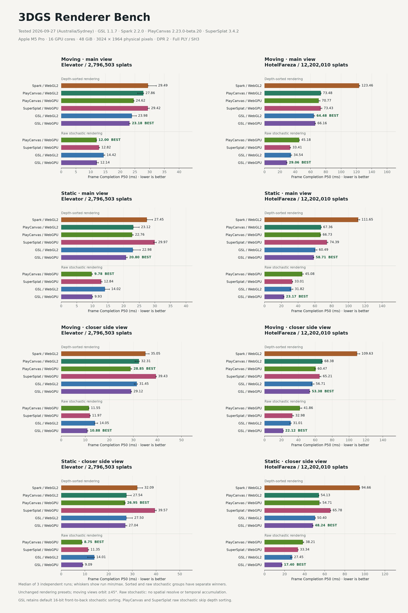

# 3DGS Renderer Bench

Measured comparisons of [Radix](https://github.com/sparkjsdev/radix), [Spark](https://github.com/sparkjsdev/spark), [PlayCanvas Engine](https://github.com/playcanvas/engine), [SuperSplat Viewer](https://github.com/playcanvas/supersplat-viewer), and [Gaussian Splat Lite](https://github.com/WilliamLiu-1997/Gaussian-Splat-Lite).

[Benchmark website](https://3dgs-renderer-bench.vercel.app) · [Interactive local report](3DGS-Renderer-Bench.html)



## Current test configuration

These measurements use GSL 1.6.2, Spark 2.4.0, Radix 0.0.1, SuperSplat Viewer 1.42.0 and [PlayCanvas 2.24.0-beta.30](https://github.com/playcanvas/engine/commit/876ba2e7dffc246b1008695f23f60ac1a9b96109). Radix runs on WebGPU and WebGL2 with its native default 24-bit sorting, using Three.js 0.186.1; GSL and Spark use 0.187.0. Tests alternate forward/reverse order, then rotate the starting backend. The three local inputs are Elevator, HotelFareza and WillaGlobalPoland.

## Current measurements

- Eight backends: Spark WebGL2; Radix WebGL2/WebGPU; GSL WebGL2/WebGPU; SuperSplat Viewer WebGPU; PlayCanvas Engine WebGL2/WebGPU.
- Full original PLY inputs with SH3 and no generated LOD hierarchy: Elevator (2,796,503), HotelFareza (12,202,010), WillaGlobalPoland (14,469,103 splats).
- Shared cameras, radial sorting, resolution, background and aligned size/blur/alpha settings. Native projection, culling, precision and caching still differ; exact settings are recorded per run.
- MacBook Pro 14, Apple M5 Pro (16 GPU cores), 48 GiB unified memory, macOS 26.7, Chrome 156.0.8078.80. Canvas: 1512 × 982 CSS pixels, DPR 2, **3024 × 1964 physical pixels**.
- Three independent runs per model/backend: **72 runs and 396 performance groups**. Each round runs every backend once per model, then reverses the order for the next round and rotates the starting backend for the following pair. Real start timestamps are checked against this schedule.
- All eight backends measure static and moving versions of both the main and closer side views (±45° orbit amplitude). Additional raw stochastic cases compare PlayCanvas WebGPU and both GSL backends; GSL retains default 16-bit front-to-back stochastic sorting. Spatial resolve and temporal accumulation are off. Sorted and stochastic results have separate winners.
- Tested **2026-11-03 (Australia/Sydney)**, derived from raw run timestamps. Each ranking uses the median across three independent runs; the report also displays each run and P95.

Frame completion includes CPU submission, GPU completion and timestamp-query readback with one frame in flight; it is not display FPS. The report presents Frame Completion P50 and P95. Sorting latency, combined JS heap + ArrayBuffer + WASM and explicit GPU allocation are separately defined in [the measurement guide](harness/README.md). Adjusting rendering settings does not remove instrumentation overhead or guarantee pixel-identical images.

## View the results

Open `3DGS-Renderer-Bench.html`. It includes English/Chinese controls, per-round comparisons and embedded screenshot previews. Original captures link to `harness/results`. No model files are required to read the report.

`benchmark-data.json` and `benchmark-summary.csv` contain summary measurements; `validation.json` records the completed checks. `harness/results` contains 72 raw run JSON files and 33 round-one captures.

## Test your own model

Open the [browser lab](https://3dgs-renderer-bench.vercel.app/test/) to compare Spark, Radix, SuperSplat Viewer, PlayCanvas and GSL across eight backends on a PLY or SPZ. Drop a local file or enter a direct HTTP(S) `.ply`/`.spz` URL with CORS enabled. Files stay in the browser; SPZ is converted to a shared PLY before testing. Downloads happen once, before renderer loading, and are timed separately.

Choose versions, camera, resolution and sampling settings; run sequentially and export JSON/PDF with screenshots. Rendering settings are adjusted as closely as possible in both tools. Lab Frame P50/P95 measure completion without the report's GPU-query readback instrumentation, so absolute times are not directly interchangeable.

With Node.js 22 or 24:

```sh
npm ci
npm run dev
# Open the printed URL (default: http://127.0.0.1:5349/test/).
```

Restart after source changes. WebGPU requires HTTPS or localhost and a supported browser/GPU. See the [lab guide](lab/README.md).

## Reproduce the measurements

Requires local Google Chrome with native WebGPU and timestamp queries. Process-memory diagnostics use Unix `ps`.

1. Place `Elevator.ply`, `HotelFareza.ply` and `WillaGlobalPoland.ply` in `models/`, or edit `harness/config.json` paths. Verify the hashes in `input-manifest.json`.
2. Run:

```sh
cd harness
npm ci
npm run build
npm run pilot
npm run bench
```

Completed results with the current protocol are skipped. New data goes to `harness/results-current` (`RESULTS_DIR` overrides it). The runner manages its own server on port 5351, configurable through `PORT`.

Backend IDs are `spark`, `radix-gpu`, `radix-gl`, `gsl-gpu`, `gsl-gl`, `viewer-gpu`, `pc-gpu`, `pc-gl`. For example, `node run.mjs hotel pc-gl pc-gpu`; `ROUNDS=1` selects a diagnostic round. Full validation expects three rounds across all three models and eight backends.

## Regenerate the report

From the repository root:

```sh
python3 -m venv .venv
.venv/bin/pip install -r tools/requirements.txt
.venv/bin/python tools/analyze.py
.venv/bin/python tools/plot.py
.venv/bin/python tools/validate.py
```

Generated files go to `outputs/`. When updating the root snapshot, copy the HTML, JSON, CSV, the overview PNG/SVG pair and validation together, and point original-image paths at `harness/results/`. Replace `harness/results/` with the matching completed raw results and captures from `harness/results-current/`. Update `input-manifest.json` with the matching hashes, protocol, versions and test dates.

## Build the website

```sh
npm run build
```

Builds the report, its current original captures, and `/test/` into `site/`. Models and the instrumented harness are not deployed. `vercel.json` configures the build with no required environment variables.

## License

Benchmark code is MIT licensed. Renderer code retains its licenses in `licenses/`. The pinned Engine snapshot and its license are in `vendor/`; Viewer and Radix retain their package licenses.
